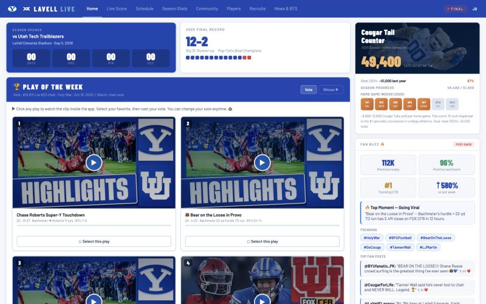

# Lavell Live — BYU Cougars Fan Hub

A single-page fan hub for BYU Football, built with plain HTML, CSS, and JavaScript (no frameworks, no build step).

**Live site:** https://mccleanjackson.github.io/lavell-live/



## Features

- **Home** — season-opener countdown, final record, "Play of the Week" voting on highlight clips, the Cougar Tail Counter, and a Fan Buzz feed
- **Live Score** — game-day view with play-by-play and a drive chart (BYU vs. Utah)
- **Schedule** — full season schedule with game previews
- **Season Stats** — team and player stat breakdowns
- **Community** — fan posts and trending topics
- **Players** — searchable, filterable roster with player bios and canvas-rendered jerseys
- **Recruits** — incoming recruiting class
- **News & BTS** — news links and behind-the-scenes video

## Tech

- One self-contained `index.html` (HTML + CSS + vanilla JS)
- Responsive grid layout, CSS custom properties for theming
- `<canvas>` drawing for the jersey renderer and field animation
- Google Fonts (Barlow, Barlow Condensed, JetBrains Mono)

## Run locally

Open `index.html` in a browser, or serve the folder:

```bash
python3 -m http.server
```

---

*Unofficial fan project, built for a portfolio. Not affiliated with BYU or the Big 12 Conference. Team names, logos, and media belong to their respective owners.*
